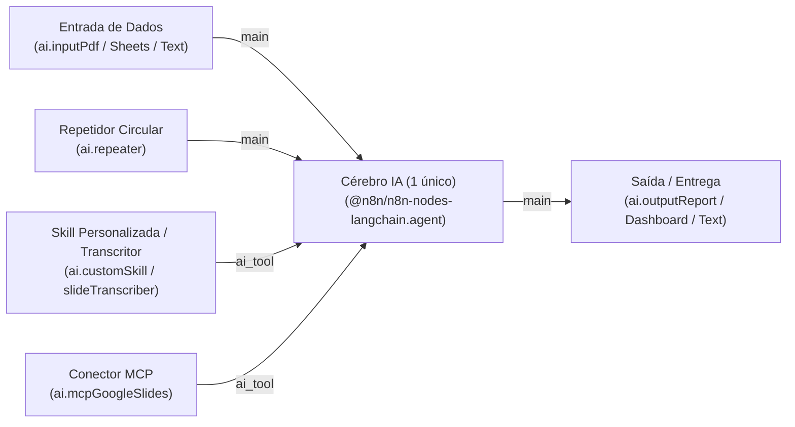

# Documentação de Arquitetura, Stack e Guia de Contexto para LLMs (`AI Agent Studio / n8n-reconstructed`)

> **Propósito deste Documento (LLM Handover / Architecture Guide)**:
> Este documento foi elaborado especificamente para que **qualquer LLM / Agente de IA ou Engenheiro de Software** que assuma este projeto compreenda imediatamente:
> 1. A arquitetura da plataforma **AI Agent Studio** (evoluída a partir da engenharia reversa do **n8n v1.118.1** via REA).
> 2. O pipeline de **Compilação de Agentes**, armazenamento estruturado no Banco de Dados (`agents.json` + `localStorage`) e sincronização de estado.
> 3. Como funciona a separação e lapidação de prompts em blocos especializados (Entrada, Cérebro IA, Skills, Repetidor, Saída).
> 4. A execução com **Google Gemini (Multimodal nativo com inlineData para PDF/Docs)**, failover automático e síntese executiva limpa (sem tags cruas `###`).
> 5. A interface conversacional ChatGPT-like (**Usar Agente**) com upload de documentos via `+`, persistência de mensagens e regras de UX/Canvas.

---

## 1. Visão Geral do Sistema

O projeto é um estúdio no-code/low-code visual focado na **criação, configuração e utilização imediata de Agentes de IA Inteligentes**. Ele opera em dois modos principais coordenados no topo:
1. **Aba "Montar Blocos" (`builder`)**: Canvas visual no grid de `16px` onde o usuário conecta blocos funcionais (Entradas de Dados, Cérebro IA, Skills Especializadas, Conectores MCP, Repetidor Circular de Prazos e Entregas Formatadas).
2. **Aba "Usar Agente" (`use-agent`)**: Interface conversacional estilo ChatGPT onde o usuário interage diretamente com o agente compilado. Permite anexar arquivos (`PDF`, `DOCX`, `TXT`, `CSV`) pelo botão **`+`**, salva todo o histórico de mensagens no banco de dados e executa chamadas multimodais ao vivo via Gemini.

---

## 2. Stack Tecnológica Completa

| Camada | Tecnologia | Função e Detalhes |
| :--- | :--- | :--- |
| **Frontend UI** | **React 18.3 + TypeScript 5.6** | Tipagem estrita de nós, conexões e mensagens. Hooks performáticos (`useMemo`, `useCallback`, `useRef`). |
| **Build & Dev Server** | **Vite 6.0** | HMR instantâneo na porta `5173` com proxy `/api` apontando para o backend na porta `4000`. |
| **Estilização** | **CSS Variables (`n8n-tokens.css`) + Inline Styles** | Tema padrão "Branco Gelo" (`#f3f7fb`), suporte a modo escuro e layout responsivo. |
| **Ícones** | **Lucide React (`lucide-react`)** | Renderização vetorial padronizada via componente central `NodeIcon.tsx`. |
| **Engine de Workflows** | **TypeScript Puro (`src/engine/`)** | Grafo direcionado (`Workflow.ts`), motor de execução determinístico (`WorkflowExecute.ts`) e geometria com auto-layout (`geometry.ts`). |
| **Compilador & DB** | **`agentDatabase.ts` + `server/db/agents.json`** | Compila nós do canvas em um registro persistente `CompiledAgentRecord`, salva histórico de chat e gerencia cache local. |
| **Provedor de LLM** | **Google Gemini API (`v1beta`)** | Execução ao vivo com suporte multimodal (`inlineData: { mimeType: 'application/pdf', data: base64 }`) e failover dinâmico (`gemini-2.5-flash` ➔ `gemini-3.8-flash`). |
| **Backend API** | **Node.js + Express 4.21 (`tsx`)** | Endpoints REST (`/api/health`, `/api/workflows`, `/api/agents`, `/api/ai/generate-workflow`, `/api/workflows/execute`). |

---

## 3. Catálogo Padronizado de Blocos e Regras de Negócio

Cada bloco possui um papel estrito no fluxo do agente:



### Regras de Ouro dos Blocos:
1. **Regra de 1 Bloco de IA por Agente**: No momento, cada agente possui exatamente **1 bloco de IA central** (`@n8n/n8n-nodes-langchain.agent`). O estúdio bloqueia a adição de múltiplos blocos de IA no canvas para garantir clareza cognitiva.
2. **Entradas (`trigger`)**: Borda azul (`#3b82f6`). Não usam ícone de raio (`⚡`). Coletam documentos, links ou textos brutos.
3. **Cérebro IA (`isConfigurable`)**: Borda coral (`#ff6d5a`). Contém papel (`agentRole`), instruções centrais (`systemMessage`), tom de voz (`toneOfVoice`) e regras negativas (`negativeInstructions`).
4. **Skills (`ai_subnode`)**: Borda âmbar (`#f59e0b`). Conectam via porta `ai_tool` (linha tracejada). Recebem **exclusivamente a instrução técnica da habilidade específica**, sem misturar com o prompt geral do agente.
5. **Conectores MCP**: Borda azul céu (`#0ea5e9`). Conectam via porta `ai_tool`. Executam chamadas de ferramentas externas (ex: Google Slides API).
6. **Repetidor (`ai.repeater`)**: Formato circular (`border-radius: 50%`, `80x80px`), borda roxa (`#8b5cf6`). Não usa raio. Configura prazos (`deadlineRule`), frequência (`repeatInterval`) e horários (`executionSchedule`).
7. **Saídas (`output`)**: Borda verde (`#16a34a`). Definem se a entrega é um Relatório Formatado, Dashboard ou Texto Direto.

---

## 4. O Pipeline de Compilação e Banco de Dados (`CompiledAgentRecord`)

Quando o usuário clica em **"Criar Agente"** (ou **"Atualizar Agente"**):

1. **Validação Estrutural (`validateAgentWorkflow`)**:
   - Garante que exista 1 bloco de IA ativo.
   - Emite avisos caso não haja entradas ou saídas explícitas.
2. **Execução de Verificação (`WorkflowExecute.run()`)**:
   - Executa o grafo do gatilho à saída.
   - Cada bloco injeta seus parâmetros reais no histórico de execução.
3. **Compilação de Prompt (`compileAgentFromWorkflow`)**:
   - Consolida as instruções de todos os blocos em um objeto estruturado:
   ```typescript
   export interface CompiledAgentRecord {
     id: string;
     name: string;
     status: 'created' | 'draft';
     createdAt: string;
     updatedAt: string;
     version: number;
     aiBrain: CompiledAiBrainConfig;
     inputs: CompiledInputConfig[];
     skills: CompiledSkillConfig[];
     mcps: CompiledMcpConfig[];
     repeater: CompiledRepeaterConfig | null;
     outputs: CompiledOutputConfig[];
     compiledSystemPrompt: string;       // Prompt unificado construído a partir dos blocos
     workflowSnapshot: IWorkflowData;    // Grafo completo dos blocos
     chatHistory: AgentChatMessageRecord[]; // Mensagens salvas
     attachedDocuments: AgentAttachedDocument[]; // Arquivos anexados salvos
   }
   ```
4. **Persistência Dupla (Isomórfica)**:
   - Salvo no `localStorage` sob a chave `ai_agent_studio_compiled_db_v1`.
   - Sincronizado via `POST /api/agents` no arquivo persistente `server/db/agents.json`.

---

## 5. Decomposição e Lapidação de Prompts ("Montar com IA")

No chat inferior (`BottomAiChatDrawer.tsx`), o usuário pode pedir para a IA montar blocos em linguagem natural (ex: *"monte um agente que lê contratos e gera relatórios de risco"*).

Para evitar que o prompt bruto seja copiado integralmente para dentro de todos os blocos, o sistema conta com a função **`decomposeAndPolishUserPrompt`** (`aiWorkflowGenerator.ts`):
- **No Bloco de Entrada**: Insere apenas instruções de coleta e leitura documental.
- **No Bloco de IA**: Lapida um papel executivo (`agentRole`), metodologia em passos e regras de conduta.
- **No Bloco de Skill**: Extrai e isola **apenas a técnica da skill** (ex: *"Auditoria de Cláusulas & Riscos"*, com exemplo de entrada e saída).
- **No Bloco de Saída**: Configura a estrutura do relatório final.
- **Filtro de Intenção**: Se o usuário fizer apenas uma pergunta (ex: *"você está aí?"*, *"olá"*), o assistente responde em texto livre **sem alterar nem bagunçar os blocos do canvas**.

---

## 6. Integração Multimodal com Google Gemini & Upload de Arquivos

### Envio de Documentos (PDF, DOCX, TXT):
- Na aba **Usar Agente** (`UseAgentChatView.tsx`), o botão **`+`** aciona um input assíncrono.
- O arquivo é lido via `FileReader.readAsDataURL` de forma não bloqueante e codificado em Base64.
- Ao clicar no `+`, o arquivo fica visível em um chip acima do campo de texto (sem poluir o chat com mensagens automáticas).
- Quando o usuário envia a mensagem, o documento e o texto vão juntos na mesma requisição.

### Chamada Multimodal à API do Gemini:
Em `agentDatabase.ts`, a chamada é enviada com suporte a documentos nativos:
```typescript
userParts.push({
  inlineData: {
    mimeType: 'application/pdf',
    data: doc.base64Data, // Gemini faz OCR e leitura visual nativa de todas as páginas
  },
});
```

### Tolerância a Falhas e Failover Rápido:
- **Failover entre Modelos**: Tenta primeiro `gemini-2.5-flash`. Caso receba erro temporário (ex: 503 Overloaded), chaveia imediatamente para `gemini-3.8-flash`.
- **Timeout Estrito (14s)**: Usa `AbortController` para abortar requisições penduradas antes que o usuário fique esperando.
- **Formatação Limpa**: Todas as respostas são higienizadas para **nunca conter tags cruas como `### ✅` ou metadados de máquina**, mantendo um tom executivo e natural.

---

## 7. Estrutura de Diretórios dos Componentes Chave

```text
n8n-reconstructed/
├── server/
│   ├── index.ts                      # API Express (rotas /api/workflows, /api/agents, etc.)
│   └── db/
│       └── agents.json               # Banco de dados persistente em arquivo JSON
├── src/
│   ├── App.tsx                       # Orquestrador do layout, abas (builder/use-agent) e sincronização do DB
│   ├── engine/
│   │   ├── agentDatabase.ts          # Compilador de agentes, persistência de chat/docs e cliente Gemini
│   │   ├── aiWorkflowGenerator.ts    # Decompositor/lapidador de prompts e gerador semântico de blocos
│   │   ├── nodeTypes.ts              # Catálogo dos 12 tipos de blocos, cores, categorias e portas
│   │   ├── workflow.ts               # Estrutura de grafo e expressões ={{...}}
│   │   ├── workflowExecute.ts        # Executor passo a passo dos blocos
│   │   └── geometry.ts               # Snapping 16px, Bézier suave e algoritmo de auto-alinhamento (Tidy Up)
│   └── components/
│       ├── TopNavBar.tsx             # Nome editável do agente, abas [Montar Blocos] e [Usar Agente], botão Criar Agente
│       ├── Canvas.tsx                # Canvas interativo (nós, conexões com handles magnéticos, minimapa)
│       ├── UseAgentChatView.tsx      # Chat estilo ChatGPT com upload (+) de documentos, histórico e barra colada à direita
│       ├── LeftSidebar.tsx           # Paleta esquerda arrastável + gatilho do assistente IA
│       ├── RightNodeSidebar.tsx      # Configurações contextuais dos nós (inputs limpos sem abas pesadas)
│       └── BottomAiChatDrawer.tsx    # Gaveta inferior para montar blocos com IA
```

---

## 8. Guia para Novas IAs / Desenvolvedores (Manutenção Segura)

Se você for adicionar novas funcionalidades ou alterar o código:
1. **Preserve a regra de 1 LLM por Agente**: Não remova a trava sem antes atualizar o compilador `agentDatabase.ts` para lidar com múltiplos cérebros em paralelo.
2. **Sempre use `FileReader` assíncrono para uploads**: Nunca processe buffers binários grandes com loops `for` síncronos na thread do React.
3. **Mantenha os Handlers de nós sincronizados**: Ao criar um novo tipo de bloco em `nodeTypes.ts`, implemente o case correspondente em `workflowExecute.ts` e adicione o extrator em `compileAgentFromWorkflow`.
4. **Verificação de Build Obrigatória**: Após qualquer alteração, execute sempre:
   ```bash
   npm run build
   ```
   O comando roda `tsc --noEmit && vite build` garantindo zero regressões de tipagem.
